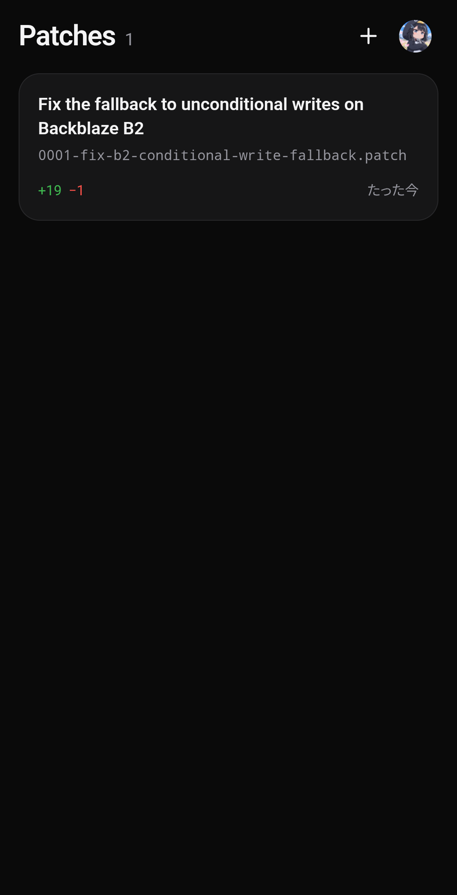
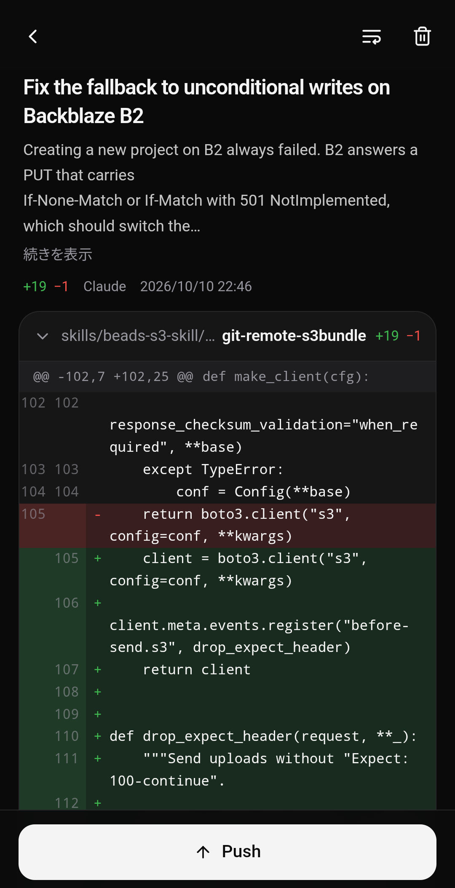

<p align="center">
  
</p>

<h1 align="center">Github Patches</h1>

<p align="center">
  パッチファイルの差分を確認して、GitHubのブランチへpushするAndroidアプリ。<br>
  <sub>クローンも端末上のgitも不要。GitHub API経由で直接コミットを作成します。</sub>
</p>

<p align="center">
  <a href="../../releases/latest"></a>
  
  <a href="LICENSE"></a>
</p>

<p align="center"><a href="README.md">English</a></p>

---

`.patch` / `.diff` を開いて差分を確認し、リポジトリとブランチを選んでpushします。
すべてのhunkが現在のブランチ先端に適用できると確認できるまで、何も書き込みません。

<p align="center">
  
  &nbsp;
  
</p>

## 機能

- 新旧の行番号付きで差分を表示します。折り返しと横スクロールを切り替えられ、バイナリやモード変更、UTF-8・Shift_JISのテキストも表示できます。
- `git format-patch` の連続パッチは、`git am` と同じくメールごとに1コミットとして元の作者・日時で作成します。1つのコミットにまとめることもできます。通常の `git diff` の出力や `diff -u` のパッチにも対応しています。
- 既存ブランチ（fast-forwardのみ）か、任意のブランチから作る新規ブランチへpushできます。新規ブランチを作成した後は、GitHubのPR作成ページを開けます。
- hunkは `git apply` と同じく、文脈行の完全一致で、記録された行番号から外側へ探してブランチ先端と照合します。位置がずれて一致したhunkや、行末の空白・CRを無視して一致したhunkは確認結果に表示します。
- パッチは共有、「アプリで開く」、ファイル選択、クリップボード、URLから取り込めます。github.com のPR・コミット・比較ページはAPI経由で取得するので、プライベートリポジトリにも使えます。
- 日本語／英語のUI、ライト／ダークテーマ。

## pushの仕組み

Git Data API で取得したブランチ先端に対し、変更対象のツリーとblobだけを読み込んで、メモリ上でパッチを適用します。その後、

1. 新しい内容をblobとしてアップロード（ローカルで計算したオブジェクトIDと照合）
2. パッチ内のコミットごとに、親ツリーをベースにツリーとコミットを作成
3. 既存ブランチは強制なし（fast-forwardのみ）でrefを更新し、新規ブランチはrefを作成

途中で他の人がそのブランチにpushしていた場合は、新しい先端に対して1回だけ適用し直します。リネームやモード変更は既存オブジェクトを再利用するので、大きなファイルでもダウンロードしません。

対応: ファイルの変更・追加・削除、リネーム／コピー（編集を含む）、モード変更、シンボリックリンク、末尾改行なし、CRLF、`GIT binary patch`（literal / delta）。
非対応: サブモジュールの変更、データを含まない `Binary files … differ`、マージコミットの結合diff（combined diff）。

## セットアップ

GitHub OAuth Device Flow で、**自分で作成した** OAuth App を使ってログインします。

1. [New OAuth App](https://github.com/settings/applications/new) を開く（名前・URLは任意）
2. **Enable Device Flow** にチェックを入れて登録
3. 表示された **Client ID** をアプリに貼り付け（Client Secretは不要）

要求するスコープは `repo`（公開・非公開リポジトリへのpush）と `workflow`（`.github/workflows` を変更するパッチ用）です。
GitHub App の Client ID も使えます。その場合は *Contents: Read and write*（ワークフローを扱うなら *Workflows* も）が必要で、pushするリポジトリにインストールしておく必要があります。

トークンは EncryptedSharedPreferences に、パッチはアプリ専用領域に保存されます。

## ビルド

必要な環境: JDK 17+、Android SDK（platform 35, build-tools 35）、Node.js 20+

```sh
cd webui && npm ci && npm run build && cd ..
./gradlew testDebugUnitTest assembleRelease
```

リリース署名は `keystore.properties`（`keystore.properties.example` 参照）または `GHPATCHES_*` 環境変数を使います。どちらもなければデバッグ鍵で署名します。

単体テストは `git` コマンドを使います。リネーム、バイナリのdelta、CRLF・Shift_JISのファイルを含むリポジトリを作り、`git format-patch` / `git diff` でパッチを生成し、Git Data API を模した実装でpushして、できたツリーを元と比較します。

## 構成

```
app/src/main/java/dev/mokouliszt/githubpatches/
  patch/PatchParser.kt  format-patchメール、git diff、unified diff（バイト単位）
  patch/Applier.kt      hunkの照合、バイナリ literal / delta、blob ID
  patch/Pusher.kt       Git Data API による確認とpush
  GitHub.kt             Device Flow、REST呼び出し、URLからのパッチ取得
  MainActivity.kt       WebViewホスト、JSブリッジ、共有／アプリで開く
webui/                  フロントエンド（React + Tailwind CSS + Radix UI）
```

## ライセンス

MIT License
