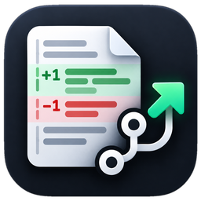
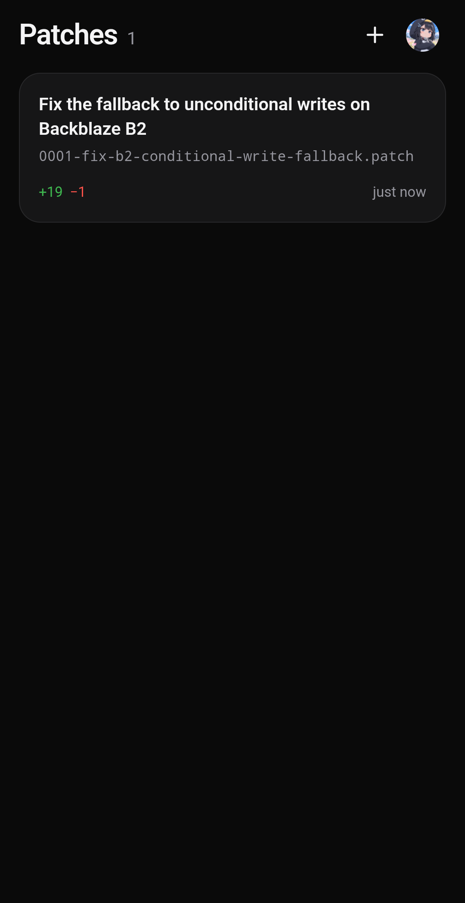
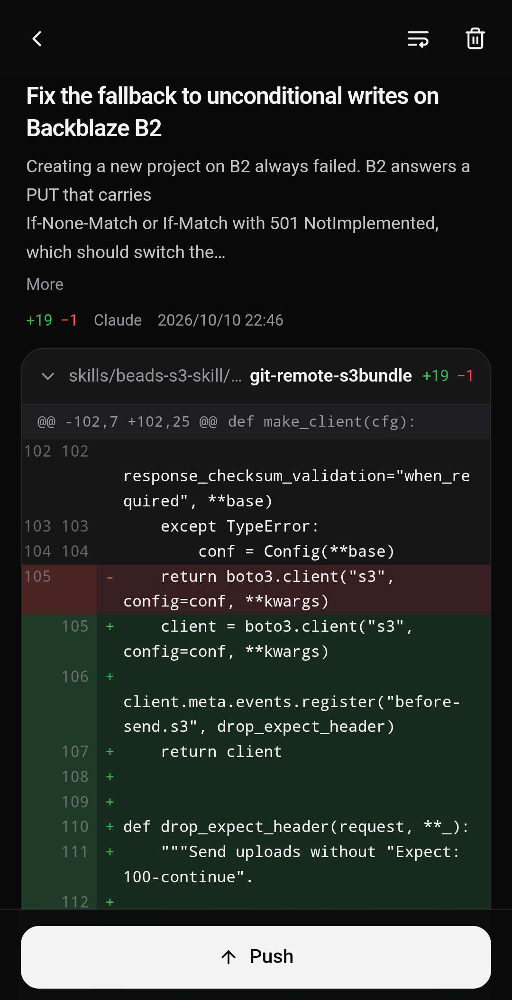

<p align="center">
  
</p>

<h1 align="center">Github Patches</h1>

<p align="center">
  An Android app to review a patch file and push it to a GitHub branch.<br>
  <sub>No clone, no git on the phone: commits are created directly through the GitHub API.</sub>
</p>

<p align="center">
  <a href="../../releases/latest"></a>
  
  <a href="LICENSE"></a>
</p>

<p align="center"><a href="README.ja.md">日本語版はこちら</a></p>

---

Open a `.patch` / `.diff` file, check the diff, then pick a repository and a branch and push.
Nothing is written until every hunk is known to apply to the current branch tip.

<p align="center">
  
  &nbsp;
  
</p>

## Features

- Diff view with old/new line numbers, line wrap or horizontal scrolling, binary and mode changes, UTF-8 and Shift_JIS text.
- A `git format-patch` series becomes one commit per mail with the original author and date, like `git am`, or a single squashed commit. Plain `git diff` output and `diff -u` patches work as well.
- Push to an existing branch (fast-forward only) or to a new branch from any base. After creating a branch, the app links to GitHub's pull request page.
- Hunks are matched against the branch tip the way `git apply` does: exact context, searched outward from their line numbers. Hunks that only match at an offset, or only with trailing whitespace / CR ignored, are shown in the check result.
- Patches can come from the share sheet, "Open with", the file picker, the clipboard, or a URL. Pull request, commit and compare pages on github.com are fetched through the API, so private repositories work.
- Japanese and English UI, light and dark theme.

## How a push works

The patch is applied in memory on top of the branch tip, reading only the trees and blobs it changes through the
Git Data API. Then:

1. new file contents are uploaded as blobs, each checked against its locally computed object ID,
2. for every commit in the patch, a tree is created on top of the parent tree, followed by the commit,
3. an existing branch is moved with a non-forced ref update; a new branch gets a new ref.

If someone pushes to the branch in the meantime, the patch is applied again on the new tip once. Renames and mode
changes reuse the existing objects, so large files are never downloaded for them.

Supported: modified, new and deleted files, renames and copies (with edits), mode changes, symlinks, files without
a final newline, CRLF files, `GIT binary patch` (literal and delta).
Not supported: submodule changes, `Binary files … differ` without data, combined diffs of merge commits.

## Setup

The app signs in with the GitHub OAuth Device Flow using **your own** OAuth App:

1. Open [New OAuth App](https://github.com/settings/applications/new). Any name and URLs work.
2. Tick **Enable Device Flow** and register.
3. Paste the **Client ID** into the app (no client secret is needed).

The app requests the `repo` scope (push to public and private repositories) and `workflow` (patches that touch
`.github/workflows`). A GitHub App client ID also works; it needs *Contents: Read and write* (and *Workflows* for
workflow files) and must be installed on the repositories you push to.

The token is stored in EncryptedSharedPreferences; patches stay in the app's private storage.

## Building from Source

Prerequisites: JDK 17+, Android SDK (platform 35, build-tools 35), Node.js 20+.

```sh
cd webui && npm ci && npm run build && cd ..
./gradlew testDebugUnitTest assembleRelease
```

Release signing uses `keystore.properties` (see `keystore.properties.example`) or `GHPATCHES_*` environment
variables. Without them the release APK is signed with the debug key.

The unit tests drive the `git` CLI: they build repositories with renames, binary deltas, CRLF and Shift_JIS files,
generate patches with `git format-patch` / `git diff`, push them through an in-process implementation of the
Git Data API, and compare the resulting trees with the originals.

## Project Structure

```
app/src/main/java/dev/mokouliszt/githubpatches/
  patch/PatchParser.kt  format-patch mails, git diffs, unified diffs (byte based)
  patch/Applier.kt      hunk matching, binary literal / delta, blob ids
  patch/Pusher.kt       check and push through the Git Data API
  GitHub.kt             Device Flow, REST calls, patch download from URLs
  MainActivity.kt       WebView host, JavaScript bridge, share / open intents
webui/                  Frontend UI (React + Tailwind CSS + Radix UI)
```

## License

MIT License
